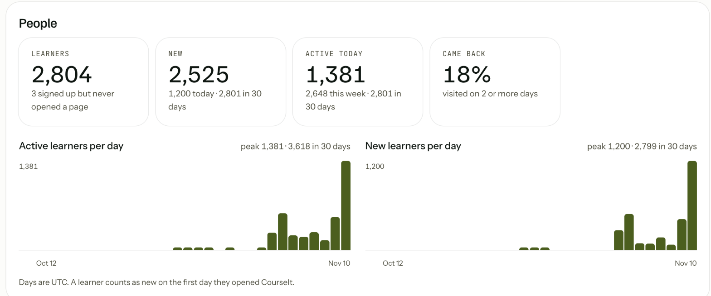
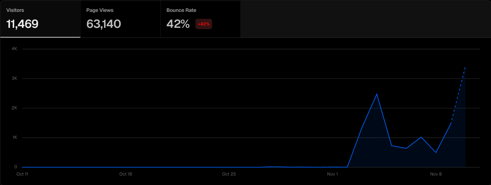
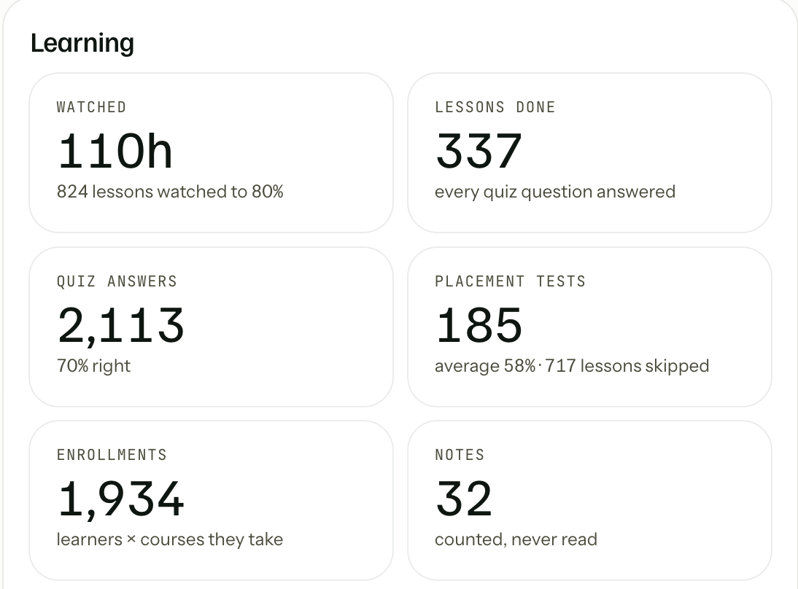
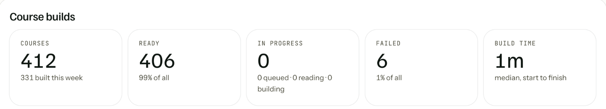
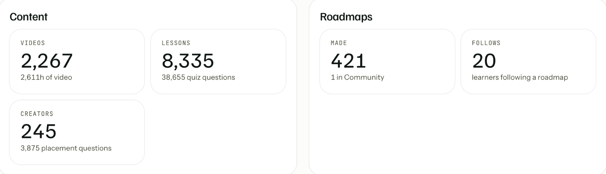
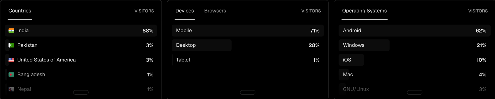
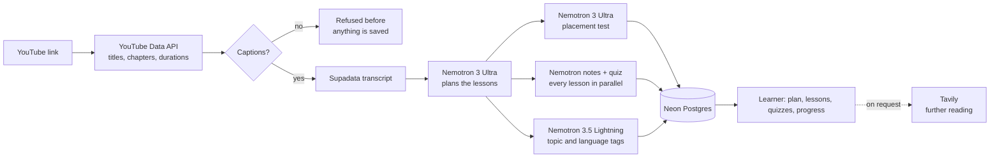

# CourseIt

<!-- NVIDIA Inception Program badge: official artwork from design.nvidia.com (unchanged). NVIDIA's rules: don't recolor, stretch or
     edit it, keep clear space around it, and never show it bigger than the CourseIt logo next to it. -->
<p>
  <a href="https://courseit.xyz"></a>
  &nbsp;&nbsp;&nbsp;
  <a href="#nvidia-inception-program"></a>
</p>

[](#how-nemotron-and-nebius-token-factory-power-it)
[](https://courseit.xyz)
[](LICENSE)

**Turn any YouTube video or playlist into a course you actually finish.**

Paste a link. NVIDIA Nemotron models on Nebius Token Factory read the video's own captions, split it into lessons, write study notes and quizzes for each one, build a placement test that skips what you already know, and pack it all into a daily plan that fits your time. You watch in YouTube's own player, so creators keep their views.

---

## Updates

### November 2026: CourseIt joins NVIDIA Inception

CourseIt is now a member of the [NVIDIA Inception program](https://www.nvidia.com/en-us/startups/), NVIDIA's program for startups building with AI and accelerated computing. See [NVIDIA Inception Program](#nvidia-inception-program) below.

### 10 November 2026: 2,804 learners, 412 courses

Real usage of [courseit.xyz](https://courseit.xyz). The figures come from CourseIt's admin dashboard (counted from the database) and Vercel Web Analytics. Nothing is estimated.

| | |
|---|---|
| **Learners signed up** | **2,804** (1,200 joined on 10 Nov alone) |
| **Active learners** | 1,381 on 10 Nov · 2,648 in the last 7 days |
| **Visitors / page views** | **11,469 visitors · 63,140 page views** in 30 days (Vercel) |
| **Courses built** | **412** (406 ready, 99%) · median build time **1 minute** |
| **Content generated** | 8,335 lessons · 38,655 quiz questions · 3,875 placement questions |
| **Video turned into courses** | 2,611 hours from 2,267 YouTube videos by 245 creators |
| **Learning** | 110 hours watched · 2,113 quiz answers (70% right) · 185 placement tests, 717 lessons skipped |
| **Enrollments** | 1,934 learner × course enrollments · 421 roadmaps made |
| **Audience** | 88% India · 71% mobile (62% Android) |

The first spike (3–4 November) came from a [reel on Abhishek's Instagram](https://www.instagram.com/p/DfRuFfvB1zA/). Top referrers since then are Google sign-in, Google search and Instagram.





<details>
<summary><b>More screenshots: learning, builds, content and audience</b></summary>

**Learning activity**



**Course builds**



**Content**



**Audience** (Vercel Web Analytics)



</details>

---

| | |
|---|---|
| **Live** | https://courseit.xyz (sign in with Google, GitHub or X) |
| **Demo video** | https://youtu.be/dm69e4neiP0 (under 3 minutes) |
| **Hackathon** | [Nebius x NVIDIA Global AI Hackathon](https://nebiusglobalaihackathon.devpost.com/), **Best Apps and Agents** track |
| **Program** | Member of the [NVIDIA Inception program](https://www.nvidia.com/en-us/startups/) |
| **Built with** | NVIDIA Nemotron 3 Ultra, Nemotron 3.5 Super and Nemotron 3.5 Lightning on **Nebius Token Factory**, plus Tavily |
| **License** | [MIT](LICENSE) |

---

## Why I built it

Andrej Karpathy's "Zero to Hero" playlist sat in my Watch Later for months. I started it three times and never got past video two: forty minutes into "Let's build GPT", YouTube would have me watching travel vlogs instead.

YouTube has the best free teachers in the world. What it doesn't have is a **course**: a plan, a finish line, and a way to check you understood. It's built to make you watch more, not learn more. CourseIt adds the structure and nothing else.

---

## The build pipeline



---

## What it does

### 1. Paste a link, get a course
- Accepts any YouTube **video or playlist** link (watch, `youtu.be`, shorts, embed, live and playlist URLs).
- Courses are built from the **video's own captions**. A video without captions is refused before anything is saved or counted; a playlist keeps only the videos that have captions.
- A public course anyone already built opens **instantly and at no AI cost**: one video is built once and shared by every learner who adds it.
- Up to 20 hours of video and 200 videos per playlist, within your plan's limits (see [Plans](#plans)).

### 2. Watch it being built, live
The build screen shows every step as it happens: fetching each transcript, which Nemotron model planned the course, each lesson being written (model, words of notes, quiz questions), and the placement test. You can start the first lesson while the rest are still being written. The median course is ready in about a minute.

### 3. A placement test that skips what you know
Nemotron 3 Ultra writes a **10-question placement test** for every course (a test with fewer than 3 usable questions is rejected and rewritten). Each question has 3 answers plus **"Skip this question"**, comes one at a time with no going back, and is tied to the 1 to 3 lessons it proves you know. Answer right, and those lessons drop out of your plan; skipping keeps them in. A "Full course / My course" toggle shows the hours and days you saved, and you can switch any lesson back into your plan.

### 4. A daily plan that fits your time
Pick how many minutes a day you have (Settings). Every course is packed into days around it, and the plan updates instantly when you change your pace or skip lessons.

### 5. Lessons built for focus
- **Focus player:** YouTube's own embed, trimmed to exactly this lesson, with keyboard shortcuts (space/K, ←/→, `<`/`>` for speed, M, C, F), remembered playback speed and autoplay into the next lesson.
- **Study notes** written by Nemotron: markdown with headings, code blocks and LaTeX math.
- **Quiz** of 4–5 questions per lesson, with explanations. A wrong answer offers **"Replay the moment"**, which jumps the video to the exact second the idea is taught.
- **Further reading** on request: "Find further reading" runs one **Tavily** search for the lesson's topic, and the links are saved so every learner sees them after that.
- **Your own notes**, pinned to the moment in the video you wrote them; click the time to jump back.
- A lesson counts as done when you've watched 80% of it or finished its quiz.

### 6. Today: your daily view
Pick up where you stopped, see what's left for today, and this week at a glance: streak, lessons finished, quiz score and time watched.

### 7. Roadmaps
Combine courses from different creators into one learning path, in stages ("Python" → "Math for ML" → "LLMs"). Paste a link straight into a stage, reorder stages, and track progress across the whole path. Roadmaps are private; **share the link** and anyone can enroll in it and follow along with their own progress, in sync with the creator's changes.

### 8. Community
- Every public course learners have built, most-taken first.
- **Search as you type**, across titles, creators and lesson titles, by whole word ("ai" doesn't match "explained").
- **Filter** by topic (programming, web, AI & data, school, entrance exams and more) and by language (English, Hindi). Nemotron 3.5 Lightning tags each new course as it's built.
- Curated roadmaps published by the CourseIt team.

### 9. Private courses
On Pro and Max, every course you build is **private**: only you see it, and it isn't listed in Community. You can make one public from its menu (one way only). If someone else pastes the same video, they get their own course; only the transcript is shared.

### 10. Everything around it
- **Inbox:** every message CourseIt emails you also lands in the app.
- **Email** through Resend: welcome, course ready, build stopped, plan started, payment failed, plan ending and renewal reminders. Each is sent once, bounced addresses are skipped, and announcements have one-click unsubscribe.
- **Notes:** all your timestamped notes, by course.
- **Support page** with email, plus Telegram (Pro) and WhatsApp (Max).
- **Admin** (for emails in `ADMIN_EMAILS`): growth and activity charts, streaks, learning totals, build health, a learners table, course and roadmap tabs, per-course lesson drop-off and build log, and Announcements to email and Inbox everyone at once. Notes and quiz answers are only ever counted, never shown.
- **Operations switches:** `PAUSE_COURSE_BUILDS=1` stops everything that costs credits while built courses stay usable; `MAINTENANCE_MODE=1` shows a "back soon" page.
- Light and dark themes, works at phone width, Privacy, Terms and Refund pages.

---

## Plans

Joining and studying a course someone already built is **always free** and never uses hours. Plans are about **building new courses**, measured in hours of video per month.

| Plan | Price (India / UK / elsewhere) | Hours a month | Longest course | Extras |
|---|---|---|---|---|
| **Basic** | ₹199 / £4.99 / $4.99 a month | 5 | 5 hours | Retry failed builds; courses shared in Community |
| **Pro** | ₹499 / £15 / $19 a month (₹4,999 / £149 / $189 a year) | 20 | 10 hours | Private courses, priority building, Telegram support |
| **Max** | ₹999 / £39 / $49 a month (₹9,999 / £389 / $489 a year) | 40 | 20 hours | Highest priority, WhatsApp and priority support, early access |

- Prices are shown in the visitor's region: rupees with GST in India, pounds with VAT in the UK, US dollars plus local tax elsewhere. India and UK checkouts are locked to that country and currency.
- Each build's hours come back 30 days after it. A failed build only counts the lessons it finished.
- Limits are checked before anything is spent; a video too long for the plan is refused with the reason.
- Pro and Max monthly prices are early-user prices; the later price is shown crossed out.
- Payments run on **Dodo Payments** (merchant of record), with in-app upgrades (Basic → Pro/Max, Pro → Max, prorated) and the Dodo customer portal for billing and invoices.
- **Until payments go live**, paid plans show "Coming soon" and everyone gets a launch offer: one free course a month, up to 10 hours.

Plans, prices and limits all live in [`src/lib/plans.ts`](src/lib/plans.ts).

---

## How Nemotron and Nebius Token Factory power it

Every word a learner reads and every decision about a course comes from **NVIDIA Nemotron on Nebius Token Factory**, called at runtime through its OpenAI-compatible API ([`src/lib/ai.ts`](src/lib/ai.ts)). Each job uses the model that fits it: Ultra where reasoning matters, smaller models where speed and cost do.

| Job | Model | Why this model | Code |
|---|---|---|---|
| **Plan the course:** read hours of transcript and split it into 8–25 minute lessons on topic boundaries (snapped to the creator's chapters) | **Nemotron 3 Ultra** (`nvidia/Nemotron-3-Ultra-550b-a55b`) | Long context plus real reasoning about where one idea ends and the next begins | `planLessons` in [`course-writer.ts`](src/lib/course-writer.ts) |
| **Write the placement test:** 10 questions mapped to the lessons they prove | **Nemotron 3 Ultra** | Has to reason across the whole course at once | `writePlacementTest` |
| **Write each lesson** on Pro and Max: notes plus a 4–5 question quiz with explanations and replay timestamps | **Nemotron 3 Ultra**, with Lightning then Super as backups | The most reliable in our benchmarks (8/8 real lessons, about 6 s each) | `writeLesson`, chosen in [`build-course.ts`](src/inngest/build-course.ts) |
| **Write each lesson** on Basic and the launch offer | **Nemotron 3.5 Lightning** (`nvidia/Nemotron-3_5-Lightning`), with Ultra as backup | Fast and very cheap (about $0.0004 a lesson); Ultra steps in for the odd lesson it can't finish | `writeLesson` |
| **Tag the course** with topics and language for Community's filters | **Nemotron 3.5 Lightning** | A tiny classification job; never holds up a build | [`course-tagger.ts`](src/lib/course-tagger.ts) |
| **Backups** when a model is busy or slow | **Nemotron 3.5 Super** (`nvidia/Nemotron-3.5-Super-VL`), Lightning, Ultra | One chain per job | `AI.fallbacks` in [`constants.ts`](src/lib/constants.ts) |

Lessons are written **in parallel**, and each lesson gets only the transcript lines inside its own time range, read straight from the database.

### What makes it reliable
- **Validated JSON on every call.** Planning, placement tests and tags use a strict JSON Schema (`response_format: json_schema`) that Token Factory enforces while the model writes. Lessons use plain JSON mode, because strict mode strips line breaks inside strings and would flatten the markdown notes. Every answer is then checked for meaning: timestamps are clamped into the video, lesson numbers must exist, and a short or half-empty lesson goes to the next model.
- **Thinking off where it doesn't pay.** With `chat_template_kwargs: { enable_thinking: false }`, planning takes about 8 s instead of 10–100 s, and lessons stay far inside the 120 s timeout. Lessons are capped at 4,000 output tokens, so a runaway answer is cheap and quick to retry.
- **Busy-proof.** On 429, 529, 5xx, a timeout or a cut-off answer, a call waits (2 s, then 6 s) and then moves down its chain of models. Every fallback is logged with its reason. A learner gets a lesson instead of an error.
- **Measured, not guessed.** [`lesson-speed.check.ts`](src/lib/lesson-speed.check.ts) benchmarks real lessons (time, tokens, cost, fallbacks) and fails if the default setup gets slow or falls back. Model changes go through it first.
- **Durable, resumable builds.** Each step (transcript, plan, every lesson, placement test, tags) is a separate [Inngest](https://www.inngest.com/) step whose result is saved. A crash or redeploy resumes where it stopped, a failed lesson doesn't sink the course, and "Retry" writes only what's missing. Paid builds run first when the queue is busy.

### Where Token Factory accelerated the work
One API key and one OpenAI-compatible endpoint gave access to every Nemotron size. Choosing a model per task and per plan, and adding backup models, is a one-line change (`AI.nemotron` / `AI.fallbacks`) instead of a new integration. When Nebius retired two models on 9 November, moving to Nemotron 3.5 Super was a change of one model id.

### Other services
- **Supadata:** fetches existing YouTube captions (1 credit per video), paced to the plan's rate limit with retries.
- **Tavily:** "Further reading" for a lesson, only when a learner asks (one search per lesson, then saved for everyone) ([`src/lib/tavily.ts`](src/lib/tavily.ts)).
- **YouTube Data API v3:** titles, durations, chapters, thumbnails and channel info.
- **Dodo Payments:** checkout, subscriptions, plan changes, invoices and the customer portal.
- **Resend:** email from `mail.courseit.xyz`, sent through Inngest.
- Nothing is downloaded from YouTube or scraped.

---

## NVIDIA Inception Program

<p></p>

CourseIt is a member of the [NVIDIA Inception program](https://www.nvidia.com/en-us/startups/), NVIDIA's free program for startups building with AI and accelerated computing. Every course CourseIt builds is planned and written by NVIDIA Nemotron models, so the program is a natural fit for where the product is going.

#NVIDIAInception

---

## Tech stack

- **Next.js 16** (App Router, Cache Components, partial prerendering, server actions), **React 19**, **TypeScript**
- **Tailwind CSS 4**, Base UI, lucide icons, Motion, sonner toasts
- **Neon Postgres** with **Drizzle ORM** (migrations in [`drizzle/`](drizzle))
- **Auth.js** (Google, GitHub, X) with the Drizzle adapter
- **Inngest** for durable background builds and email
- **Dodo Payments**, **Resend**, React Email
- **Vercel** hosting (Singapore, next to the database) and Vercel Web Analytics

---

## Run it locally

**You need:** Node 20+, pnpm, a Neon (or any Postgres) database, and API keys for Nebius Token Factory, YouTube Data API v3, Supadata and at least one sign-in provider. Tavily, Resend and Dodo Payments are optional.

```bash
git clone https://github.com/abhishek-01k/courseIt.git
cd courseIt
pnpm install

cp .env.example .env.local   # then fill it in; every variable is explained in the file
pnpm db:migrate              # create the tables

pnpm dev                     # the app, on http://localhost:3000
pnpm inngest:dev             # in a second terminal: the background job runner that builds courses
```

Open http://localhost:3000, sign in, and paste a YouTube link on **New course**. The build screen shows each step as it runs.

### Environment variables

| Variable | Required | What it's for |
|---|---|---|
| `AUTH_SECRET` | yes | Signs the session cookie (`npx auth secret`) |
| `AUTH_GOOGLE_ID` / `_SECRET`, `AUTH_GITHUB_ID` / `_SECRET`, `AUTH_TWITTER_ID` / `_SECRET` | at least one pair | Sign-in providers |
| `DATABASE_URL` | yes | Postgres connection string (Neon pooled URL) |
| `NEBIUS_API_KEY` | yes | Nebius Token Factory: every Nemotron call |
| `YOUTUBE_API_KEY` | yes | YouTube Data API v3 |
| `SUPADATA_API_KEY` | yes | YouTube captions |
| `SUPADATA_RPS` | optional | Requests per second your Supadata plan allows (default 1) |
| `TAVILY_API_KEY` | optional | "Find further reading" on lessons |
| `INNGEST_DEV=1` | locally | Use the local Inngest dev server |
| `ADMIN_EMAILS` | optional | Comma-separated emails that get `/admin` |
| `RESEND_API_KEY`, `RESEND_WEBHOOK_SECRET`, `EMAIL_FROM`, `EMAIL_REPLY_TO`, `APP_URL` | optional | Email and the Inbox's email side |
| `SUPPORT_TELEGRAM`, `SUPPORT_WHATSAPP` | optional | Chat support for paid plans |
| `PAUSE_COURSE_BUILDS`, `MAINTENANCE_MODE` | optional | Operations switches (see above) |
| `DEV_COUNTRY` | locally | Which region's prices to show (IN, GB or US) |
| Dodo Payments keys and product ids | optional | Paid plans; read in [`src/lib/plans.ts`](src/lib/plans.ts) and [`src/lib/dodo.ts`](src/lib/dodo.ts). Without them, paid plans show "Coming soon" |

### Checks

The core logic has small self-checks you can run without a database:

```bash
pnpm dlx tsx src/lib/pace.check.ts            # packing lessons into days
pnpm dlx tsx src/lib/placement.check.ts       # which lessons a placement test skips
pnpm dlx tsx src/lib/course-writer.check.ts   # validating and clamping model output
pnpm dlx tsx src/lib/youtube.check.ts         # parsing YouTube links
pnpm dlx tsx src/lib/paths.check.ts           # URLs and slugs
pnpm dlx tsx src/lib/tavily.check.ts          # a broken Tavily answer never breaks a lesson
pnpm dlx tsx src/lib/dodo.check.ts            # payment webhooks accept real signatures only
pnpm lint && pnpm build
```

`src/lib/lesson-speed.check.ts` benchmarks lesson writing on real lessons from a **dev** database and costs a few cents of Nebius per run.

---

## Project structure

```
src/
  app/                 routes: (public) landing, pricing and legal, (auth) login, (protected) the app,
                       api/ (auth, billing, webhooks, inngest, email, watch time)
  inngest/             build-course.ts (the durable build pipeline), send-email, send-announcement, renewal-reminders
  lib/
    ai.ts              Nemotron on Token Factory: JSON calls, retries, backup models
    course-writer.ts   prompts and output validation: lesson plan, lessons and quizzes, placement test
    course-tagger.ts   topics and language for Community
    plans.ts, billing.ts, dodo.ts   plans, limits, usage and payments
    transcript.ts, youtube.ts, tavily.ts, pace.ts, placement.ts
  modules/             one folder per screen: dashboard, course, lesson, placement, roadmap, community,
                       pricing, settings, inbox, support, admin, announcements, …
  emails/              email templates
  db/schema.ts         Drizzle schema
drizzle/               SQL migrations
scripts/               one-off scripts (tagging old courses, Dodo product descriptions)
docs/stats/            the screenshots in Updates
```

---

## Feedback on Nebius Token Factory and Nemotron

**What worked well**
- The OpenAI-compatible endpoint meant no SDK and no new integration: one `fetch` to `/v1/chat/completions` reaches every Nemotron size.
- Having several Nemotron sizes behind one key made per-task and per-plan model choice, and fallback chains, simple to build.
- Nemotron 3 Ultra's long context handles hours of transcript in one call, which is what makes whole-course planning and placement tests possible.
- Strict `json_schema` output works with Nemotron and fixed the malformed answers we saw with plain `json_object` mode (a question's options returned as one string, or JSON that didn't parse).

**What could be better**
- **Capacity under parallel load.** Writing every lesson of a course at once can hit busy responses (429 / 529), so CourseIt needed retries plus a chain of backup models. A `Retry-After` header, or a documented way for the platform to route to a fallback model, would remove most of that code.
- **Uneven speed between models.** On 5 November we measured Nemotron 3.5 Super at 5–8 tokens per second while other models ran at 140–230, so lessons timed out and fell back. A public status or throughput page per model would help apps route around it.
- **Strict mode strips line breaks.** With strict `json_schema`, newlines inside string values disappear, which flattens markdown. We had to switch lessons back to `json_object` and validate ourselves.
- **Model retirements.** A removed model returns an error rather than "busy", so a fallback chain doesn't kick in. Earlier notice in the API (a deprecation header) would make retirements painless.
- **Thinking mode is easy to miss.** Thinking was the difference between about 8 s and up to 100 s for planning. The per-request switch (`chat_template_kwargs.enable_thinking`) deserves a prominent place in the docs, with typical latencies, and a note that thinking tokens count towards `max_tokens`.

---

## Built during the hackathon

CourseIt was started from scratch for this hackathon: the first commit is from 23 October 2026 (see the [commit history](https://github.com/abhishek-01k/courseIt/commits/main)).

## License and credits

[MIT](LICENSE) © 2026 Triggerfy Services. CourseIt is a product of [Triggerfy](https://triggerfy.xyz).

© 2026 NVIDIA, the NVIDIA logo, and Nemotron are trademarks and/or registered trademarks of NVIDIA Corporation in the U.S. and other countries.

Videos play in YouTube's own player and belong to their creators; CourseIt never downloads them. Made by [Abhishek Kumar](https://www.linkedin.com/in/abhishek-01k/) · [X](https://x.com/abhish_3k).
