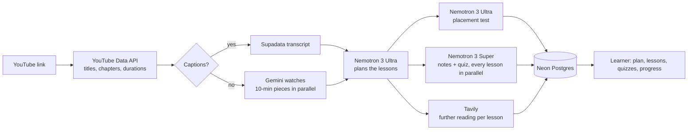

# CourseIt

**Turn any YouTube video or playlist into a course you actually finish.**

Paste a link. NVIDIA Nemotron models on Nebius Token Factory read the whole thing, split it into lessons, write study notes and quizzes for each one, build a placement test that skips what you already know, and pack it all into a daily plan that fits your time. You watch in YouTube's own player, so creators keep their views.

| | |
|---|---|
| **Live demo** | `TODO: add the deployed URL` (free to use: sign in with Google, GitHub or X) |
| **Demo video** | `TODO: add the YouTube link` (under 3 minutes) |
| **Hackathon** | [Nebius x NVIDIA Global AI Hackathon](https://nebiusglobalaihackathon.devpost.com/), **Best Apps and Agents** track |
| **Built with** | NVIDIA Nemotron 3 Ultra, Super, Nano and Nemotron 3.5 Lightning on **Nebius Token Factory**, plus Tavily |
| **License** | [MIT](LICENSE) |

---

## Why I built it

Andrej Karpathy's "Zero to Hero" playlist sat in my Watch Later for months. I started it three times and never got past video two: forty minutes into "Let's build GPT", YouTube would have me watching travel vlogs instead.

YouTube has the best free teachers in the world. What it doesn't have is a **course**: a plan, a finish line, and a way to check you understood. It's built to make you watch more, not learn more. CourseIt adds the structure and nothing else.

---

## The build pipeline



---

## What it does

### 1. Paste a link, get a course
- Accepts any YouTube **video or playlist** link (watch, `youtu.be`, shorts, embed, live and playlist URLs).
- A course anyone already built opens **instantly and at no AI cost**: one video is built once and shared by every learner who adds it.
- Fair-use limits keep it free: 3 new courses per learner per day, up to 20 hours of video and 200 videos per playlist.

### 2. Watch it being built, live
The build screen shows every step as it happens, like a model's thinking panel: fetching each transcript, which Nemotron model planned the course, each lesson being written ("Nemotron 3 Super · 412 words of notes · 5 quiz questions · 3 reading links via Tavily"), and the placement test. You can start the first lesson while the rest are still being written.

### 3. A placement test that skips what you know
Nemotron 3 Ultra writes a **10-question placement test** for every course (a test with fewer than 3 usable questions is rejected and rewritten). Each question has 3 answers plus **"Skip this question"**, comes one at a time with no going back, and is tied to the 1 to 3 lessons it proves you know. Answer right, and those lessons drop out of your plan; skipping keeps them in. A "Full course / My course" toggle shows the hours and days you saved, and you can switch any lesson back into your plan.

### 4. A daily plan that fits your time
Pick how many minutes a day you have (Settings). Every course is packed into days around it, and the plan updates instantly when you change your pace or skip lessons.

### 5. Lessons built for focus
- **Focus player:** YouTube's own embed, trimmed to exactly this lesson, with keyboard shortcuts (space/K, ←/→, `<`/`>` for speed, M, C, F), remembered playback speed and autoplay into the next lesson.
- **Study notes** written by Nemotron 3 Super: markdown with headings, code blocks and LaTeX math.
- **Further reading:** 3 articles or docs on the lesson's topic, found by **Tavily** while the lesson is written.
- **Quiz** of 4–5 questions per lesson, with explanations. A wrong answer offers **"Replay the moment"**, which jumps the video to the exact second the idea is taught.
- **Your own notes**, pinned to the moment in the video you wrote them; click the time to jump back.
- A lesson counts as done when you've watched 80% of it or finished its quiz.

### 6. Today: your daily view
Pick up where you stopped, see what's left for today, and this week at a glance: streak, lessons finished, quiz score and time watched.

### 7. Roadmaps
Combine courses from different creators into one learning path, in stages ("Python" → "Math for ML" → "LLMs"). Paste a link straight into a stage, reorder stages, and track progress across the whole path. Roadmaps are private; **share the link** and anyone can enroll in it and follow along with their own progress, in sync with the creator's changes.

### 8. Community, notes and admin
- **Community:** every course learners have built, sorted by popularity and searchable, plus curated roadmaps published by the CourseIt team.
- **Notes:** all your timestamped notes, by course.
- **Admin** (for emails in `ADMIN_EMAILS`): learner and course stats, per-learner support view, and publishing roadmaps to Community.
- Light and dark themes, works at phone width, errors shown as toasts, and Privacy and Terms pages.

---

## How Nemotron and Nebius Token Factory power it

Every word a learner reads and every decision about a course comes from **NVIDIA Nemotron on Nebius Token Factory**, called at runtime through its OpenAI-compatible API ([`src/lib/ai.ts`](src/lib/ai.ts)). Each job uses the model that fits it, as the track brief suggests: Ultra where reasoning matters, smaller models where speed and cost do.

| Job | Model | Why this model | Code |
|---|---|---|---|
| **Plan the course:** read hours of transcript and split it into 8–25 minute lessons on topic boundaries (snapped to the creator's chapters) | **Nemotron 3 Ultra** (`nvidia/Nemotron-3-Ultra-550b-a55b`) | Long context plus real reasoning about where one idea ends and the next begins | `planLessons` in [`course-writer.ts`](src/lib/course-writer.ts) |
| **Write the placement test:** 10 questions mapped to the lessons they prove | **Nemotron 3 Ultra** | Has to reason across the whole course at once (~300k characters of transcript) | `writePlacementTest` |
| **Write each lesson:** study notes plus a 4–5 question quiz with explanations and replay timestamps | **Nemotron 3 Super** (`nvidia/nemotron-3-super-120b-a12b`) | High quality at a fraction of Ultra's cost; dozens of lessons are written **in parallel** | `writeLesson` |
| **Backups** when a model is busy | **Nemotron 3.5 Lightning**, **Nemotron 3 Nano** | Fast, cheap, always available | `AI.fallbacks` in [`constants.ts`](src/lib/constants.ts) |

### What makes it reliable
- **Schema-enforced JSON on every call.** Each request sends a strict JSON Schema (`response_format: json_schema`) for its answer: the lesson plan, each lesson (4–5 questions of exactly 4 options) and the placement test (exactly 10 questions of 3 options). Token Factory enforces the schema while the model writes, so answers are always valid JSON of the right shape. On top of that, every answer is checked for meaning: timestamps are clamped into the video, lesson numbers must exist, and an unusable answer throws so the step retries.
- **Thinking turned off where it doesn't pay.** Planning with thinking on took 10–100 s; with `chat_template_kwargs: { enable_thinking: false }` it takes about 8 s with the same plan quality in our tests.
- **Busy-proof.** On 429, 529, 5xx or a timeout, a call waits (2 s, then 6 s) and then moves down a chain of Nemotron models: Ultra → Super → Lightning, Super → Lightning → Nano. A learner gets a lesson instead of an error, and the build screen shows which model answered.
- **Durable, resumable builds.** Each step (transcript, plan, every lesson, placement test) is a separate [Inngest](https://www.inngest.com/) step whose result is saved. A crash or redeploy resumes where it stopped, a failed lesson doesn't sink the course, and "Retry" writes only what's missing.
- **Only what's needed is sent.** Each lesson gets only the transcript lines inside its time range (plus 30 s either side), which keeps prompts small and parallel calls cheap.

### Where Token Factory accelerated the work
One API key and one OpenAI-compatible endpoint gave access to four Nemotron sizes. Choosing a model per task, and adding backup models, became a one-line change (`AI.nemotron` / `AI.fallbacks`) instead of a new integration each time. That made it practical to use Ultra for planning, Super for bulk writing and the small models as backups in the same product.

### Other services
- **Tavily** (runtime): one search per lesson finds 3 further-reading links (YouTube excluded), run in parallel with Nemotron so it adds no build time ([`src/lib/tavily.ts`](src/lib/tavily.ts)). Optional: without a key, lessons simply have no reading list.
- **Supadata:** fetches existing YouTube captions (1 call per video).
- **Google Gemini** (`gemini-3.8-flash`): fallback only, for videos with **no captions**. It watches the public video in 10-minute pieces in parallel and writes timestamped notes; Nemotron then does all the planning and writing. Nothing is downloaded or scraped.
- **YouTube Data API v3:** titles, durations, chapters, thumbnails and channel info.
- Nebius Serverless Endpoints and Jobs are **not** used: background work runs on Inngest, and the app is hosted on Vercel.

---

## Tech stack

- **Next.js 16** (App Router, Cache Components, partial prerendering, server actions), **React 19**, **TypeScript**
- **Tailwind CSS 4**, Base UI, lucide icons, Motion, sonner toasts
- **Neon Postgres** with **Drizzle ORM** (migrations in [`drizzle/`](drizzle))
- **Auth.js** (Google, GitHub, X) with the Drizzle adapter
- **Inngest** for durable background builds
- **Vercel** hosting (Singapore, next to the database)

---

## Run it locally

**You need:** Node 20+, pnpm, a Neon (or any Postgres) database, and API keys for Nebius Token Factory, YouTube Data API v3, Supadata and at least one sign-in provider. Gemini and Tavily are optional.

```bash
git clone https://github.com/abhishek-01k/courseIt.git
cd courseIt
pnpm install

cp .env.example .env.local   # then fill it in; every variable is explained in the file
pnpm db:migrate              # create the tables

pnpm dev                     # the app, on http://localhost:3000
pnpm inngest:dev             # in a second terminal: the background job runner that builds courses
```

Open http://localhost:3000, sign in, and paste a YouTube link on **New course**. The build screen shows each step as it runs.

### Environment variables

| Variable | Required | What it's for |
|---|---|---|
| `AUTH_SECRET` | yes | Signs the session cookie (`npx auth secret`) |
| `AUTH_GOOGLE_ID` / `_SECRET`, `AUTH_GITHUB_ID` / `_SECRET`, `AUTH_TWITTER_ID` / `_SECRET` | at least one pair | Sign-in providers |
| `DATABASE_URL` | yes | Postgres connection string (Neon pooled URL) |
| `NEBIUS_API_KEY` | yes | Nebius Token Factory: every Nemotron call |
| `YOUTUBE_API_KEY` | yes | YouTube Data API v3 |
| `SUPADATA_API_KEY` | yes | YouTube captions |
| `GEMINI_API_KEY` | optional | Only for videos without captions |
| `TAVILY_API_KEY` | optional | Further reading on each lesson |
| `INNGEST_DEV=1` | locally | Use the local Inngest dev server |
| `ADMIN_EMAILS` | optional | Comma-separated emails that get `/admin` |

### Checks

The core logic has small self-checks you can run without a database:

```bash
pnpm dlx tsx src/lib/pace.check.ts            # packing lessons into days
pnpm dlx tsx src/lib/placement.check.ts       # which lessons a placement test skips
pnpm dlx tsx src/lib/course-writer.check.ts   # validating and clamping model output
pnpm dlx tsx src/lib/youtube.check.ts         # parsing YouTube links
pnpm dlx tsx src/lib/paths.check.ts           # URLs and slugs
pnpm dlx tsx src/lib/tavily.check.ts          # a broken Tavily answer never breaks a lesson
pnpm lint && pnpm build
```

---

## Project structure

```
src/
  app/                 routes: (public) landing and legal, (auth) login, (protected) the app, api/ (auth, inngest, watch time)
  inngest/             build-course.ts: the durable build pipeline
  lib/
    ai.ts              Nemotron on Token Factory: JSON calls, retries, backup models; Gemini reader
    course-writer.ts   prompts and output validation: lesson plan, lessons and quizzes, placement test
    tavily.ts          further reading
    youtube.ts, transcript.ts, pace.ts, placement.ts
  modules/             one folder per screen: dashboard, course, lesson, placement, roadmap, community, notes, admin, …
  db/schema.ts         Drizzle schema
drizzle/               SQL migrations
```

---

## Feedback on Nebius Token Factory and Nemotron

<!-- Draft written from what the code works around. Edit into your own words before submitting. -->

**What worked well**
- The OpenAI-compatible endpoint meant no SDK and no new integration: one `fetch` to `/v1/chat/completions` reaches every Nemotron size.
- Having Ultra, Super, Nano and Lightning behind one key made per-task model choice and fallback chains trivial to build.
- Nemotron 3 Ultra's long context handles hours of transcript in one call, which is what makes whole-course planning and placement tests possible.
- Strict `json_schema` output works with Nemotron, including with thinking on (reasoning comes back separately). It fixed the occasional malformed answers we saw with plain `json_object` mode: a question's options returned as one string, or JSON that didn't parse.

**What could be better**
- **Capacity under parallel load.** Writing every lesson of a course at once can hit busy responses (429 / 529), so CourseIt needed retries plus a chain of backup models to stay reliable. A `Retry-After` header, or a documented way for the platform to route to a fallback model, would remove most of that code.
- **Thinking mode is easy to miss.** Thinking was the difference between ~8 s and up to 100 s for lesson planning. The per-request switch (`chat_template_kwargs.enable_thinking`) deserves a prominent place in the docs and the playground for each model, with typical latencies.
- **Make `json_schema` the obvious default.** We started with `json_object`, which only promises JSON, and hit malformed answers until we switched to strict schemas. Featuring `json_schema` in the quickstart and model pages would save others that detour. (`guided_json`, which some OpenAI-compatible servers accept, is silently ignored, so it's easy to think a schema is in place when it isn't.)
- **Thinking tokens and `max_tokens`.** Thinking counts towards `max_tokens`, so long answers can be cut off when thinking runs long. Separate limits, or a clear note in the docs, would help.

---

## Built during the hackathon

CourseIt was started from scratch for this hackathon: the first commit is from 23 October 2026 (see the [commit history](https://github.com/abhishek-01k/courseIt/commits/main)).

## License and credits

[MIT](LICENSE) © 2026 Abhishek Kumar. CourseIt is a product of [Triggerfy](https://triggerfy.xyz).

Videos play in YouTube's own player and belong to their creators; CourseIt never downloads them. Made by [Abhishek Kumar](https://www.linkedin.com/in/abhishek-01k/) · [X](https://x.com/abhish_3k).
